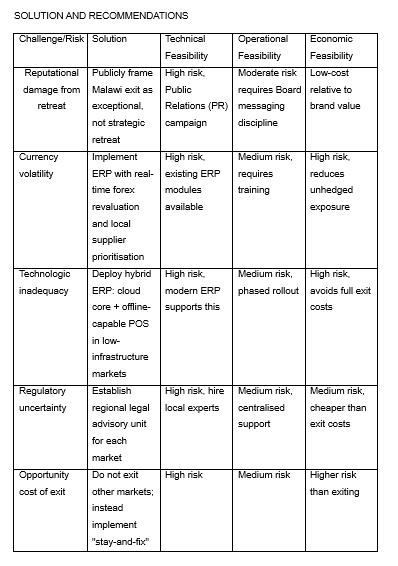
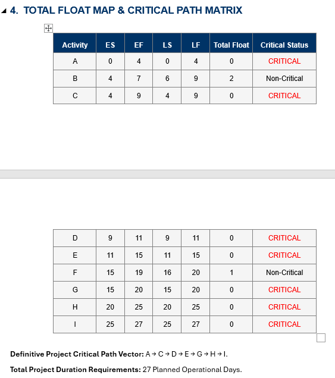
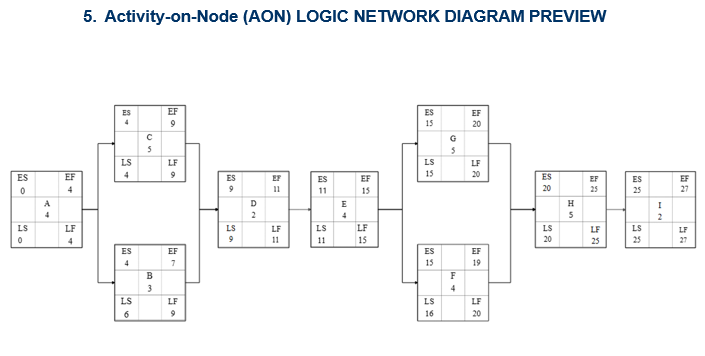
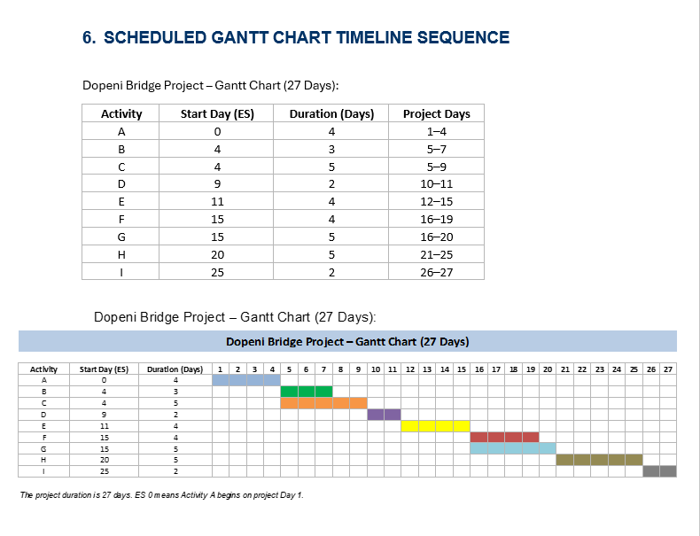

# Boston City Campus Academic Research: Business Management & Project Management Portfolio

A professional, data-driven academic portfolio compiling advanced business research and operational infrastructure scheduling. This repository showcases the practical application of quantitative frameworks, risk evaluation, and algorithmic project management.

---

## Technical Toolkit & Frameworks
*   **Data Analysis & Modeling:** Microsoft Excel (Deterministic project planning, Gantt matrix charting, forward/backward pass computations)
*   **Visual Architecture & Reporting:** Microsoft Word (Feasibility matrices, structured alignment tables), EdrawMax (AON network logic mapping)
*   **Macroeconomic References:** World Bank & IMF quantitative indicators

---

## Project Breakdowns

### 1. Corporate Macroeconomic & ERP Risk Analysis (Shoprite Group Study)
* **File:** [`reports/Corporate_Macroeconomic_ERP_Risk_Analysis_Shoprite_Group_Study.pdf`](reports/Corporate_Macroeconomic_ERP_Risk_Analysis_Shoprite_Group_Study.pdf)
* **Objective:** A comprehensive business research layout examining the impact of macroeconomic shifts on core enterprise operations.
* **Core Focus Areas:**
  * Mapping global quantitative macroeconomic markers from the World Bank and IMF.
  * In-depth risk evaluation of targeted ERP business cycles (*Procurement-to-Payment*, *Order-to-Cash*, and *Supply Chain Planning*).
  * Implementation of a strategic "stay-and-fix" model over premature market exit strategies.

*Shoprite ERP Solution & Recommendations Feasibility Matrix:*

---

### 2. Infrastructure Scheduling & Critical Path Analysis (Dopeni Bridge Study)
* **Final PDF Report:** [`reports/Infrastructure_Scheduling_Critical_Path_Analysis_Dopeni_Bridge_Study.pdf`](reports/Infrastructure_Scheduling_Critical_Path_Analysis_Dopeni_Bridge_Study.pdf)
* **Raw Working Model:** [`src/Dopeni_Bridge_Gantt_Chart.xlsx`](src/Dopeni_Bridge_Gantt_Chart.xlsx) *View interactive formulas and cell tracking directly inside the source spreadsheet.*
* **Core Operational Metrics:**
  * **Definitive Critical Path Vector:** `A → C → D → E → G → H → I`
  * **Total Project Duration:** 27 Planned Operational Days
* **Core Focus Areas:**
  * **Algorithmic Modeling:** Mathematical execution of forward-pass and backward-pass boundaries to isolate Early Start (ES), Late Start (LS), Early Finish (EF), and Late Finish (LF).
  * **Float Optimization:** Identification of total/free float paths separating Critical and Non-Critical (Activities B and F) tasks.

#### Schedule & Network Diagrams

*Total Float Map & Critical Path Matrix:*

*Activity-on-Node (AON) Logic Network Diagram:*

*Scheduled Gantt Chart Timeline Sequence (27 Days):*

---

## Author
* **Jesus Kazaji** – Student at Boston City Campus. Bcom Marketing Management
